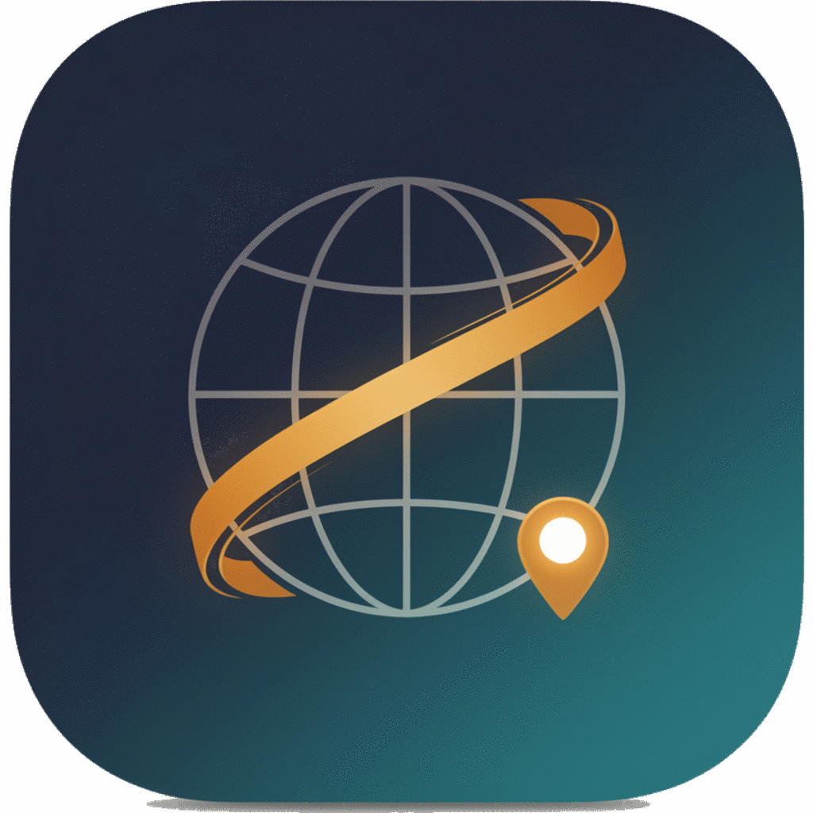

<p align="center">
  
</p>

# WorldHistory Atlas

Исследовательский инструмент по мировой истории: глубокие досье по странам, эпохам, войнам и спорным темам с сопоставлением источников, проверкой фактов и разбором популярных мифов.

Работает как веб-приложение (PWA, офлайн) и как **нативное Android-приложение** (`WorldHistory-Atlas.apk` — файл лежит в корне репозитория и прикреплён к релизам).

---

## Что нового

| Возможность | Описание |
|---|---|
| **Глубокие досье** | 5 эпох, 8 военных конфликтов и 19 крупнейших государств разобраны по единой схеме: причины (долгосрочные / среднесрочные / повод), последствия (военные, политические, гуманитарные, долгосрочные), хронология, историографические школы, проверка утверждений и мифов. |
| **Проверка мифов** | Отдельный блок объясняет, почему популярное утверждение неверно (например, «пирамиды строили рабы», «в Средние века верили в плоскую Землю», «Наполеон проиграл из-за морозов»). |
| **Прозрачные источники** | Каталог из 25+ отобранных ресурсов с указанием типа, уровня доверия и возможной заинтересованности; шкала достоверности от «высокая» до «позиция стороны». |
| **Самопроверка** | Тесты в конце досье с пояснениями по каждому вопросу. |
| **Режимы исследования** | Быстрый обзор / глубокое исследование / академический режим (сразу к источникам). |
| **Работа без backend** | Поиск и досье запрашивают Wikipedia, Wikidata, OpenAlex, Crossref и Internet Archive прямо из браузера; без интернета открываются локальные досье и кэш. |
| **Офлайн и «Сохранённое»** | Досье сохраняются на устройстве (localStorage + service worker) и читаются без сети. |
| **Мобильный UX** | Mobile-first вёрстка, нижняя панель навигации, безопасные зоны (safe-area), крупные тач-цели, тёмная и светлая темы. |
| **Экспорт** | Markdown, печать/PDF (в приложении — через системную печать), публичный шеринг, копирование ссылки. |
| **Android-приложение** | Подписанный APK собирается одной командой без Android SDK и Gradle. |

---

## Установка на телефон (Android)

**Скачать APK:**
[`WorldHistory-Atlas.apk`](https://raw.githubusercontent.com/AlfaGideon/WorldHistory/main/WorldHistory-Atlas.apk)
· [страница файла на GitHub](https://github.com/AlfaGideon/WorldHistory/blob/main/WorldHistory-Atlas.apk)

Размер ~0.6 МБ, `minSdk 24` — Android 7.0 и новее. Файл лежит в корне репозитория (ветка `main`) и всегда соответствует последней версии приложения.

Как установить:

1. Скопируйте APK на телефон (кабель, облако, Telegram, e-mail — как угодно).
2. Откройте файл на устройстве → «Установить».
3. Android попросит разрешить установку из неизвестных источников для вашего проводника/мессенджера — разрешите.
4. Готово: ярлык **WorldHistory** появится в меню приложений.

> Если телефон пишет «Приложение не установлено» при обновлении — удалите старую версию: сборки подписываются разными ключами.
> Для постоянной подписи задайте свой keystore: `WH_KEYSTORE=~/my.jks WH_KEY_ALIAS=worldhistory WH_KEYSTORE_PASSWORD=*** WH_KEY_PASSWORD=*** npm run android:build`.

Через компьютер:

```bash
adb install -r WorldHistory-Atlas.apk
```

Приложение самодостаточно: весь интерфейс и каталог досье лежат внутри APK, поэтому оно работает без интернета. С сетью подгружаются свежие материалы Wikipedia, Wikidata, OpenAlex, Crossref и Internet Archive; внешние ссылки открываются в браузере.

### Сборка APK из исходников

```bash
npm install
npm run android:build      # результат: WorldHistory-Atlas.apk
```

Скрипт сам скачивает нужные инструменты в `.cache/android-tools` (aapt2, android.jar, d8, ecj, apksigner), а при отсутствии Java — портативную JRE (`scripts/fetch-android-tools.sh`) — Android SDK и Gradle не нужны.

Проверить, что упакованное приложение стартует в WebView, можно одной командой:

```bash
npm run android:smoke     # загружает dist/index.html как file:// и проверяет отрисовку
```

Структура нативной части:

```
android/
  AndroidManifest.xml
  res/…                     # иконки и тема
  java/com/worldhistory/atlas/MainActivity.java   # WebView + мост для шеринга/печати/файлов
scripts/
  build-android.mjs         # сборка, выравнивание и подпись APK
  build-icons.sh            # нарезка логотипа в иконки PWA/Android
  fetch-android-tools.sh    # скачивание aapt2, android.jar, d8, ecj, apksigner и JRE
  smoke-android.mjs         # дымовой тест упакованного приложения
  zipkit.mjs                # ZIP-читатель/писатель с 4-байтовым выравниванием (аналог zipalign)
assets/
  logo.png                  # мастер-логотип 1024×1024 (прозрачный фон)
  logo-source.png           # исходный рендер без обрезки фона
```

### Логотип и иконки

Мастер-файл — `assets/logo.png` (квадрат с прозрачным фоном). После его замены запустите:

```bash
bash scripts/build-icons.sh    # public/icons/*.png, android/res/mipmap-*/ic_launcher.png, src/assets/brand-logo.png
```

Скрипт сам сделает все размеры для браузера и PWA (32–512), маскируемые версии (`*-maskable.png`, логотип на плотном фоне) и иконки лаунчера Android.

---

## Запуск в браузере

Требуется Node.js 22.5 или новее (backend использует встроенный модуль SQLite).

```bash
npm install
npm run dev       # frontend + backend
npm run dev:web   # только Vite
npm run dev:api   # только API
```

Сборка и проверки:

```bash
npm run build           # веб-сборка (ES-модули, code splitting)
npm run build:android   # сборка для APK (классический script, относительные пути)
npm run lint
npm test
```

### Запуск на Windows через bat-файл

Дважды кликните `start-worldhistory.bat`. Скрипт проверит Node.js, обновления, порты и зависимости, поднимет backend (3001) и frontend (5173) и откроет браузер.

Если страница показывает «Ошибка API: 502» — значит, frontend работает, а backend нет: посмотрите лог в консоли (обычно это старый Node.js или занятый порт 3001).

---

## Как устроен поиск и досье

Приложение работает в четыре слоя и никогда не выдумывает факты:

1. **Курированные досье** (`src/data/`) — проверенные материалы, доступные офлайн. Всегда показываются первыми.
2. **Backend API** (`/api/…`) — когда запущен Express-сервер (умеет ходить через Tor и прокси).
3. **Браузерные провайдеры** (`src/services/liveProviders.js`) — те же Wikipedia, Wikidata, OpenAlex, Crossref и Internet Archive, но напрямую из браузера (работает в APK и на статическом хостинге).
4. **Честный план исследования** — если источников нет вообще, показывается структура будущего разбора и объяснение, почему данных нет.

Ключевой принцип: **утверждение без подтверждения помечается как спорное или как позиция стороны**, а не выдаётся за факт.

## Структура досье

| Раздел | Содержание |
|---|---|
| Обзор | Инфобокс (тип, даты, регион, участники, итог, уверенность), краткое резюме, быстрые факты, статус информации, ключевые источники |
| Причины и итоги | Долгосрочные и среднесрочные причины, повод; военные, политические, гуманитарные и долгосрочные последствия |
| Хронология | Датированные ключевые моменты с указанием статуса («подтверждено», «оценки различаются») |
| Стороны | Позиции участников и историографических школ с обязательной оговоркой о их ограничениях |
| Спорное | Что известно точно, что спорно, что является позицией стороны, мифы и упрощения — с объяснением оценки |
| Источники | Материалы с типом, заинтересованностью и уровнем доверия |
| Проверка | Тест по материалам досье с пояснениями |

---

## Backend API

- `GET /api/health`
- `GET /api/search?q=Франция`
- `GET /api/dossier/:query` — универсальное досье; `?refresh=1` принудительно перезагружает данные
- `GET /api/source/analyze?url=https://example.com`
- `GET /api/network/settings` — настройки подключения и автопоиск Tor
- `PUT /api/network/settings` — сменить маршрут (direct / tor / custom)
- `POST /api/network/test` — диагностика маршрутов

Backend **не обязателен**: без него приложение использует браузерные провайдеры и локальный каталог. Полный анализатор URL доступен только при запущенном backend.

## Настройки подключения и Tor Browser

Если внешние источники недоступны напрямую, откройте раздел **«Настройки»** и выберите маршрут:

- **Напрямую** — обычное подключение;
- **Tor Browser** — запросы идут через SOCKS5-прокси `127.0.0.1:9150` (служба tor — 9050);
- **Свой прокси** — HTTP/HTTPS/SOCKS5 с ручным адресом.

Кнопка **«Проверить соединение»** опрашивает Wikipedia всеми маршрутами, показывает время отклика, exit-IP и проверку «идёт ли трафик через Tor».

Переменные окружения: `PROXY_MODE`, `PROXY_URL`, `TOR_SOCKS_HOST`, `TOR_SOCKS_PORT`, `REQUEST_TIMEOUT_MS`, `DB_PATH`, `EUROPEANA_KEY`, `OPENALEX_EMAIL`.

## SQLite и кэш

При запуске backend создаёт `data/worldhistory.sqlite`: результаты поиска — 7 дней, досье — 1 год, разобранные источники — 30 дней. Просроченный кэш используется как резерв при недоступности провайдеров.

В браузере и приложении работает собственный кэш (localStorage + service worker): поиск — 7 дней, досье — 90 дней. Очистить его можно в разделе «Настройки → Данные и офлайн-режим».

## PWA

`public/manifest.webmanifest` и `public/sw.js` дают установку на домашний экран и офлайн-работу: оболочка и ассеты кэшируются, ответы `/api/*` сохраняются как резерв.

## Документация планов

- `ROADMAP.md` — таблица улучшений со статусами;
- `IDEAS.md` — рабочий список идей и правил работы.
